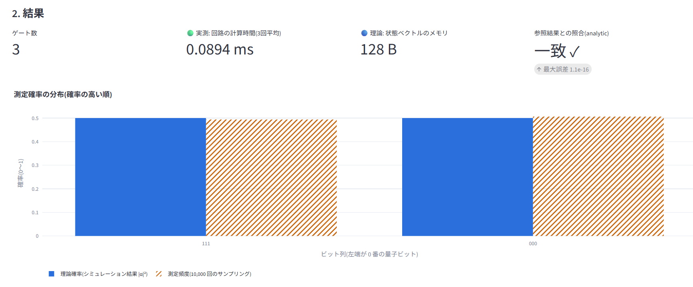
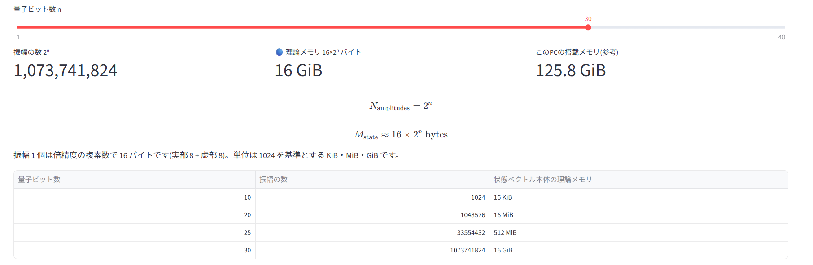
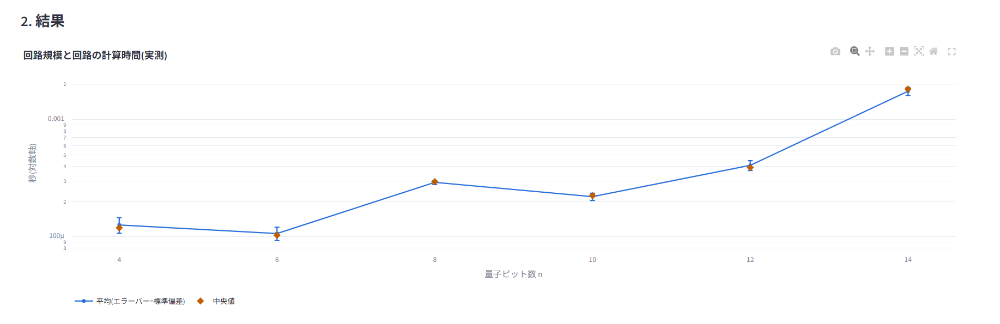
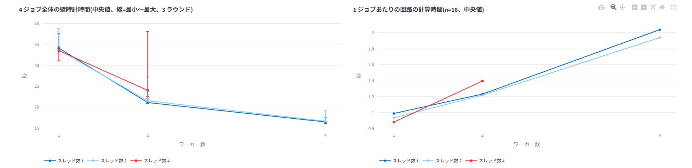

# quantum-sim-bench

CPU 上で動作する量子回路の状態ベクトルシミュレーション & 性能計測ツールです。量子回路の実行・可視化に加えて、ベンチマーク手法や並列実行時の性能特性の分析までを一つのアプリケーションとして実装しています。

**実行環境: CPU(NumPy)のみ。GPU は使用していません。** GPU・Docker・Slurm・複数ノードへの対応は本リポジトリの範囲外です(詳細は「現状とロードマップ」を参照)。

**ライブデモ: <https://quantum-sim-bench-rm5zlvzcacm43umvgc9quk.streamlit.app/>**
(Streamlit Community Cloud 上でホスティング。インストール不要でブラウザから利用できます。12 時間アクセスがないとスリープするため、再開時は起動を待つ画面が表示されます。計算は共有 CPU 上で実行されるため、表示される時間は実行環境ごとに変動します。)

## 概要

量子コンピュータの計算を通常の CPU 上でシミュレーションし、量子ビット数や並列実行条件を変えたときに計算時間・メモリ使用量がどのように変化するかを測定・可視化します。量子計算の基礎から、性能評価・並列処理の設計まで一貫して扱っているのが特徴です。

- **回路シミュレーション**: GHZ 状態 / 量子フーリエ変換(QFT) / ランダム回路を実行し、測定確率・複素振幅・実行時間を表示
- **メモリコスト分析**: 量子ビット数 n に対する理論メモリ(16×2ⁿ バイト)を実行せずに確認
- **ベンチマーク**: 実行時間・メモリ・ばらつき(変動係数)を、解析解や Qiskit との一致確認付きで計測し、CSV 出力
- **並列実行の性能分析**: ワーカー数とスレッド数を独立に振った実測データを解釈の限界込みで可視化
- **学習コンテンツ**: 状態ベクトル・GHZ・QFT・各指標の数式と解説(掲載値は実際の計算結果)

### 実装で示している技術領域

- 数値計算: 複素ベクトルによる量子状態シミュレーション、解析解・密行列・Qiskit によるクロスバリデーション
- 性能計測: 統計的に妥当なベンチマーク設計(ウォームアップ除外、反復測定、変動係数による評価)
- 並行処理: マルチプロセスのジョブキュー、BLAS スレッド数の制御と実測による検証
- ソフトウェア品質: pytest による自動テスト(正当性・統計・ジョブ管理・UI)
- プロダクト設計: Streamlit による、非専門家にも理解できる UI/UX とドキュメント

## スクリーンショット

公開環境(Streamlit Community Cloud)で撮影した実際の画面です。計算は共有 CPU 上の実行のため、表示される時間・メモリは撮影時の環境での値です。

**トップページ**(目的と使い方の 3 ステップ)


**回路を試す**: 3 量子ビットの GHZ 状態。理論確率と測定頻度が `000` と `111` で約 0.5 ずつとなり、参照結果と一致(最大誤差 1.1e-16)



**規模とコスト**: n=30 の理論メモリは 16 GiB。量子ビット数に対するメモリ要求の指数的増大を直感的に確認できます



**性能測定**: 回路の実行時間(実測)。量子ビット数が小さい領域では準備時間が支配的になり、単調に増加しない場合があります



**並列実行の分析**: ワーカー数×スレッド数を独立に振った実測データ(事前測定済みデータを同梱)



## クイックスタート

### 環境構築(Windows / PowerShell)

```powershell
cd "<このフォルダのパス>"
python -m venv .venv-clean
.\.venv-clean\Scripts\python.exe -m pip install -r requirements-dev.txt
.\.venv-clean\Scripts\python.exe -m pip install -e . --no-deps
```

動作確認済み: Windows 11 / Python 3.11.0。`requirements-dev.txt` はアプリの依存関係(`requirements.txt`)にテスト用の pytest・qiskit を加えたものです。アプリの実行のみであれば `requirements.txt` で十分です。

### 起動

```powershell
.\start_app.bat                                                          # 仮想環境を自動検出して起動
.\.venv-clean\Scripts\python.exe -m streamlit run app\streamlit_app.py   # 直接起動
```

ブラウザで `http://localhost:8501` を開きます。「▶ 3 量子ビットの GHZ 状態を計算する」を押すと、1 秒以内に結果が表示されます。終了は `Ctrl+C`。

### 画面構成

| タブ | 内容 |
|---|---|
| はじめに | 概要、3 ステップ、ワンクリックのデモ |
| ① 回路を試す | 回路・量子ビット数を選んで実行。結果の読み方付き |
| ② 規模とコスト | n と振幅数・理論メモリの関係(実行しない) |
| ③ 性能測定 | 時間・メモリ・ばらつきの測定、CSV 出力 |
| ④ 並列実行の実測例 | ワーカー数×スレッド数の実測データ(同梱) |
| ⑤ 数式としくみ | 数式・具体例・コードとの対応 |
| ⑥ 用語集 | 検索できる用語集 |

## 量子シミュレーションの仕組み

状態ベクトル方式では、n 個の量子ビットの状態を 2ⁿ 個の複素振幅 α_x で表します。

$$|\psi\rangle=\sum_{x=0}^{2^n-1}\alpha_x|x\rangle,\qquad P(x)=|\alpha_x|^2,\qquad \sum_x|\alpha_x|^2=1$$

- 実装は長さ 2ⁿ の `complex128` 配列(`src/qsimbench/statevector.py`)。量子ビット 0 番がインデックスの最上位ビット(ビット列の左端)
- ゲートは `tensordot` で該当する軸に作用させて更新。確率は絶対値の 2 乗
- **メモリ**: 振幅数 $2^n$、状態ベクトル本体の理論メモリ $M\approx16\times2^n$ バイト(例: n=20 で 16 MiB、n=30 で 16 GiB)。状態ベクトル本体のみの理論値で、計算中のピークは一時配列のため大きくなります(実測で約 3 倍)
- **GHZ 状態**: $|\mathrm{GHZ}_n\rangle=(|0\rangle^{\otimes n}+|1\rangle^{\otimes n})/\sqrt2$。測定すると全 0 か全 1 が確率 1/2 ずつ
- **QFT**: $|x\rangle\mapsto\frac1{\sqrt N}\sum_{y}e^{2\pi i xy/N}|y\rangle$($N=2^n$)。出力は `numpy.fft.ifft` と一致することを自動テストで確認済み(`tests/test_explain.py`)

詳しい解説(記号の意味・具体例・コードとの対応)はアプリの「⑤ 数式としくみ」にあります。

## ベンチマークと並列実行の設計

- **ベンチマーク手法**: 同じ条件で複数回測定し、平均・中央値・最小・最大・標準偏差・変動係数(CV = 標準偏差 ÷ 平均)で評価。ウォームアップ回は除外。時間は `perf_counter`、メモリは別実行で `tracemalloc`(Python/NumPy 確保量のピーク。OS 全体の使用量ではない)
- **ワーカー数**: 独立したジョブを同時に動かす数(スループット向けの設定)。**スレッド数**: 1 ジョブ内で BLAS が計算を分担する数
- 並列化しても CPU・メモリ帯域・キャッシュは共有されるため、1 ジョブあたりの時間が伸びることがあり、常に高速化するとは限りません。バッチ全体の経過時間と、ジョブ内の計算時間は別の量として記録します
- 各ジョブのスレッド数は `threadpoolctl` で設定し、実際に適用された値を検出して記録(`job.json` の `thread_info`)

### 実測結果

QFT n=16,18、各条件 4 ジョブ × 3 ラウンド、条件の順序は seed 付きでシャッフル(`docs/measurements/`)。測定環境: i7-8550U(4 コア/8 スレッド)ノート PC、CPU のみ。

| ワーカー | スレッド | 経過時間 中央値 [s](最小〜最大) | 1 ジョブの回路時間 n=18 [s] |
|---:|---:|---|---:|
| 1 | 1 | 34.1 (34.1〜37.7) | 0.99 |
| 1 | 2 | 33.7 (32.9〜38.9) | 0.93 |
| 1 | 4 | 33.5 (31.1〜34.4) | 0.88 |
| 2 | 1 | 21.1 (20.9〜22.0) | 1.23 |
| 2 | 2 | 21.5 (21.4〜27.4) | 1.22 |
| 2 | 4 | 24.0 (22.5〜38.1) | 1.40 |
| 4 | 1 | 16.4 (16.1〜17.4) | 2.04 |
| 4 | 2 | 16.6 (16.5〜19.1) | 1.94 |

(ワーカー 4 × スレッド 4 は論理コア数 8 を超えるため、本測定では保守的にスキップしています。回路時間はラウンドごとの中央値の中央値)

**観察された傾向**: ワーカーを増やすと経過時間は短縮(1→2 で約 1.6 倍速、1→4 で約 2.1 倍速)しましたが、1 ジョブあたりの回路時間は伸びました。スレッド設定は全 96 ジョブで要求どおり適用されたことを確認しています。

**この測定の限界**: スレッド数単体の効果(測定範囲が重なり断定不可)、経過時間が伸びる原因の切り分け(メモリ帯域・ハイパースレッディング・CPU 周波数は未分離)、最適設定の特定(1 台・1 種類の負荷・3 ラウンドのみ)、他の PC・GPU・クラスタへの一般化は、いずれも本測定の対象外です。

## テスト

```powershell
.\.venv-clean\Scripts\python.exe -m pytest -q
```

シミュレータの正当性(解析解・密行列・Qiskit との一致)、ジョブ管理、スレッド設定の反映、並列実験、UI に表示する数式とコードの整合、グラフと元データの一致、UI 操作(Streamlit の `AppTest`)を自動テストで検証しています。実ブラウザでの目視確認は別途実施(スクリーンショット参照)。

## 技術リファレンス

### CLI

```powershell
python -m qsimbench run configs/example_small.toml
python -m qsimbench run configs/example_small.toml configs/example_qft.toml --out results
```

実行ごとに `results/<日時>-<name>/` が新規作成されます(既存は上書きしません)。

| ファイル | 内容 |
|---|---|
| `config.toml` | 実験条件(同じファイルで再実行可能) |
| `results.csv` | n ごとの時間・ばらつき・メモリ・誤差・TVD |
| `job.json` | ステータス、終了コード、所要時間、エラー、実行環境、設定ハッシュ |
| `run.log` | 実行ログ |

終了コード: 0=成功 / 1=実行エラー / 2=設定エラー / 3=メモリ不足。

### ジョブ管理(ローカルキュー)

複数の実験設定を「ジョブ」として登録し、ローカル CPU 上で同時実行数に上限をつけて実行します(単一 PC 内のファイルベースの実装。Slurm 等の HPC スケジューラではありません)。

```powershell
python -m qsimbench submit configs/example_small.toml configs/example_qft.toml   # 登録(queued)
python -m qsimbench work --workers 2                                             # 実行(既定は 1 = 逐次)
python -m qsimbench list                                                         # 一覧
python -m qsimbench show <job_id>                                                # 詳細(JSON)
python -m qsimbench retry                                                        # 失敗ジョブを新ジョブとして再登録
python -m qsimbench cancel <job_id>                                              # queued のみ取り消し可
python -m qsimbench export --jobs jobs.csv --results results_all.csv             # CSV 出力
python -m qsimbench compare-workers configs/example_parallel.toml configs/example_parallel.toml --workers 1 2
python -m qsimbench analyze results/<run>/results.csv                            # スケーリング要約
```

#### アーキテクチャ

```
CLI (cli.py)
 ├─ run ─────────────────────────────▶ jobs.execute()  直接実行
 └─ submit/work/list/retry/... ─▶ jobqueue.py(スケジューラ)
                                    │ 子プロセスを最大 workers 個まで起動
                                    ▼
                          python -m qsimbench worker <job_dir>
                                    └▶ jobs.execute() ─▶ circuits / statevector / reference / benchmark
jobs/<job_id>/  job.json  config.toml  worker.log  worker_result.json  runs/<run_id>/{config.toml,job.json,run.log,results.csv}
```

各ジョブを別プロセスにしているのは、(1) 1 ジョブの異常終了が他に波及しない、(2) OS 視点の資源使用量をジョブ単位で取得できる、という 2 点のためです。

#### ジョブの状態遷移

```
queued ──▶ running ──▶ succeeded
   │           └─────▶ failed
   └──▶ cancelled
```

- `work` はあるジョブが失敗しても既定で残りを実行します(`--fail-fast` で停止可能)。
- 同時実行は `--workers`(既定 1、上限は論理コア数)。各ジョブの推定ピークメモリの合計が利用可能 RAM の 60% を超える場合は起動を待たせます。
- 各ジョブの BLAS スレッド数は `--threads-per-job` で指定し、`OMP/OPENBLAS/MKL_NUM_THREADS` として子プロセスに渡した上で、`job.json` に実測値を記録します。

### 並列性能評価(`sweep`)

workers と threads を独立の軸として格子状に測定します。

```powershell
python -m qsimbench sweep configs/example_sweep.toml --workers 1 2 4 --threads 1 2 4 --jobs-per-condition 4 --rounds 3 --seed 0
```

- 各ラウンドで全条件を seed 付きでシャッフルした順に実行(発熱や他プロセスの影響が特定条件に偏らないようにするため)
- workers × threads が論理コア数を超える条件は既定でスキップ(`--allow-oversubscribe` で実行可)
- 出力は `sweeps/<日時>-<hex>/` に新規作成(`sweep.json` / `rounds.csv` / `summary.csv` / `jobs/`)

各ジョブのワーカーは計算前に `threadpoolctl` で BLAS のスレッド数を設定し、計算前後で `threadpool_info()` により実際に適用された値を検証します(`job.json` の `thread_info.status`: `ok` / `mismatch` / `no_library_detected` など)。

### 計測の定義(実測 / 理論)

| 量 | 種別 | 方法 |
|---|---|---|
| 実行時間 | 実測 | `time.perf_counter`、ウォームアップ除外後の反復平均・標準偏差・最小・中央値・変動係数 |
| ピークメモリ | 実測 | `tracemalloc` のピーク(時間とは別実行、プロセス RSS ではなく Python/NumPy 確保分) |
| 状態ベクトルサイズ | 理論値 | 16·2ⁿ バイト(complex128) |
| 時間のべき乗フィット | 実測値へのフィット | n ≥ 12 の log₂(時間)–n の傾き(外挿ではない) |

### 測定例(1 回の実行、参考値)

`configs/example_qft.toml`(QFT、ウォームアップ 1、反復 5)、i7-8550U / RAM 7.9 GiB / Python 3.11.0 / NumPy 2.2.6。他環境と直接比較できる数値ではありません。

| n | 平均時間 [s] | 標準偏差 [s] | ピークメモリ実測 | 参照との最大誤差 |
|---|---|---|---|---|
| 12 | 0.00396 | 0.00031 | 0.19 MB | 6e-17 |
| 16 | 0.154 | 0.0007 | 3.1 MB | 2e-17 |
| 18 | 0.594 | 0.0031 | 12.6 MB | 8e-18 |
| 20 | 3.78 | 0.154 | 50.4 MB | 4e-18 |

n=20 のピーク実測は理論サイズ(16.8 MB)の約 3 倍で、ゲートごとに同サイズの一時配列が生じる実装の性質と整合します。

### 結果 CSV の列(`results.csv`)

| 列 | 種別 | 意味 |
|---|---|---|
| `qubits`, `gates` | 条件 | 量子ビット数、ゲート数 |
| `time_mean_s` / `time_std_s` / `time_median_s` | 実測 | 反復時間の統計量 |
| `time_cv` | 実測から算出 | 変動係数 std/mean |
| `gates_per_s` | 実測から算出 | ゲート数 ÷ 平均時間 |
| `peak_mem_bytes_measured` | 実測 | tracemalloc のピーク |
| `statevector_bytes_theory` | 理論値 | 16·2ⁿ バイト |
| `max_abs_error_vs_reference` | 検証 | 参照計算との最大絶対誤差 |
| `tvd_sampling_vs_sim` | 実測 | サンプリング頻度とシミュレーション確率の全変動距離 |

### 構成

```
src/qsimbench/
  circuits.py      回路表現とビルダー
  statevector.py   状態ベクトルシミュレータ(CPU)
  reference.py     参照計算(解析解・密行列)
  benchmark.py     時間・メモリ・環境の計測
  jobs.py          設定(TOML/JSON)、1 回の実験実行、結果保存(UI非依存)
  jobqueue.py      ローカルジョブキュー(登録・並列実行・再実行・資源記録)
  analysis.py      結果CSVのスケーリング要約
  threads.py       BLASスレッド数の設定と、実際に適用された値の検出(threadpoolctl)
  sweep.py         workers × スレッド数 の比較実験
  cli.py           CLI
app/streamlit_app.py   UI(計算は qsimbench に委譲)
configs/               実験条件
tests/                 自動テスト
```

## 現状とロードマップ

| 項目 | 状態 |
|---|---|
| ローカル CPU シミュレーション + Web UI | 実装・テスト済み |
| CLI・バッチ実行・ログ/終了コード | 実装・テスト済み |
| ベンチマーク基盤(統計量、条件付き CSV、失敗行記録) | 実装・テスト済み |
| ローカルジョブ管理(キュー、並列実行、再実行、資源記録) | 実装・テスト済み(単一 PC のみ。実行中ジョブの中断は未対応) |
| 並列性能評価(workers / threads 分離、`sweep`) | 実装・テスト済み。本測定(8 条件 × 3 ラウンド × 4 ジョブ、全 96 ジョブ成功)を実施 |
| 学習者向け UI・解説(数式・用語集) | 実装・自動テスト済み。公開環境での目視確認済み(5 画面) |
| 一般公開 | 公開済み(Streamlit Community Cloud) |
| Docker 対応 | 未完了(ビルド未検証) |
| Slurm 連携 / 複数ノード / GPU 対応 | 未着手 |

### 既知の制約

- 理想的な(ノイズなし)純粋状態のみを対象。ノイズ・密度行列・誤り訂正は対象外
- 並列化は NumPy/BLAS 任せの部分があり、OS レベルの資源競合まで完全には制御していません
- メモリ実測は `tracemalloc` であり、OS 視点の使用量とは異なります
- 実際の HPC クラスタ・GPU・クラウド環境での実行結果ではなく、ノート PC の CPU 上の数値です

### スケーリング限界

状態ベクトルのメモリは n が 1 増えるごとに 2 倍になります(n=30 で 16 GiB、n=40 で 16 TiB、理論値)。本アプリは安全のため最大 25 量子ビット(状態 512 MiB、ピーク約 1.5 GiB)に制限しています。これを超える規模にはメモリ分散や GPU が必要ですが、本リポジトリの対象外です。

## 困ったときは

| 症状 | 対処 |
|---|---|
| 「このシステムではスクリプトの実行が無効」(PowerShell) | `activate` を使わず `.\.venv-clean\Scripts\python.exe -m ...` で直接実行、または `start_app.bat` を使う |
| `streamlit` が見つからない | `.\.venv-clean\Scripts\python.exe -m streamlit run app\streamlit_app.py` |
| `ModuleNotFoundError: qsimbench` | `.\.venv-clean\Scripts\python.exe -m pip install -e . --no-deps` |
| ブラウザが開かない / ポートが使用中 | `http://localhost:8501` を手動で開く。使用中なら `--server.port 8502` を付けて起動 |
| qiskit のインストールが長いパスで失敗(Windows) | 短いパス(例 `C:\qv`)に仮想環境を作る(Windows の 260 文字パス制限が原因) |
| 計算が重い・メモリ不足 | 量子ビット数を下げる(UI の「実行前チェック」で負荷を確認) |

## ライセンス

MIT ライセンス(著作権者: koki)。詳細は [LICENSE](LICENSE) を参照してください。

## 用語集

アプリの「⑥ 用語集」に、詳しい説明付きで同じ内容があります。

<!-- GLOSSARY:START -->
- **量子ビット（qubit）** — 量子計算の最小単位。普通のビットが 0 か 1 のどちらかなのに対し、0 と 1 の「重ね合わせ」を取れる。
- **量子状態** — 量子ビットの「いまの状態」。このアプリでは、複素数の並び(状態ベクトル)で表す。
- **重ね合わせ** — 「0 でもあり 1 でもある」ように、複数の状態が振幅という重みつきで同時に含まれていること。
- **複素振幅** — 各ビット列に対応する複素数。大きさの 2 乗が測定確率、角度(位相)は干渉に効く。
- **測定確率** — 測定したときに、あるビット列が得られる確率。振幅 α に対して |α|²。
- **量子ゲート** — 量子状態を変える操作。数学的には、状態ベクトルにかける行列(ユニタリ行列)。
- **量子回路** — 量子ゲートを順番に並べた計算の手順。
- **GHZ状態** — 全部 0 の状態と全部 1 の状態の重ね合わせ。測定すると全 0 か全 1 のどちらかだけが半々で得られる。
- **QFT** — 量子フーリエ変換。古典の離散フーリエ変換に対応する量子回路。
- **状態ベクトルシミュレーション** — 量子状態の全ての振幅(2ⁿ 個)をメモリに持ち、ゲートごとに更新して計算するシミュレーション方式。
- **ベンチマーク** — 決まった条件でプログラムを実行して、性能(時間・メモリなど)を測り、比較すること。
- **ワーカー** — 独立したジョブ(実験)を同時に実行するプロセスの数。
- **スレッド** — 1 つのプロセスの中で、計算を分担して並列に進める仕組み。ここでは BLAS(行列演算ライブラリ)の並列数。
- **並列実行** — 複数の処理を同時に進めること。ワーカー(ジョブ間)とスレッド(ジョブ内)の 2 つの階層がある。
- **メモリ使用量** — プログラムが使うメモリの量。理論値と実測値は別物。
- **参照結果** — シミュレータの計算が正しいかを確かめるための、別の方法で求めた正解。
- **数値誤差** — コンピュータの有限桁の計算で生じる、真の値とのわずかなずれ。
- **変動係数（CV）** — ばらつきの大きさを平均に対する割合で表した値。標準偏差 ÷ 平均。
- **基底状態・ビット列** — 「000」「101」のような、0 と 1 の並びで決まる状態。n 量子ビットなら 2ⁿ 通りある。
- **位相** — 複素振幅の角度。確率(大きさ)には現れないが、ゲートを重ねたときの強め合い・打ち消し合いを決める。
- **正規化** — 全てのビット列の確率を足すと 1 になること(Σ|α|²=1)。
- **干渉** — 複素振幅が足し合わされるとき、位相がそろえば強め合い、逆なら打ち消し合う現象。
- **もつれ（エンタングルメント）** — 複数の量子ビットの状態が、1 つずつに分けて書けない関係。
- **ショット（測定回数）** — 同じ回路を何回測定するか。
- **乱数シード** — 乱数の出方を決める数。同じ値なら同じ乱数列になり、結果を再現できる。
- **代表的なゲート(H・CX・CP・SWAP・RY・RZ)** — H: 重ね合わせを作る / CX: 片方が 1 のときだけ他方を反転 / CP: 片方が 1 のとき位相を回す / SWAP: 入れ替え / RY・RZ: 回転。
- **解析解** — 式で書ける、正確な答え。
- **密行列** — 2ⁿ×2ⁿ の全要素を持つ行列。ここでは、回路全体を 1 つの行列で表したもの。
- **TVD（全変動距離）** — 2 つの確率分布の違いの大きさ。0 なら完全に一致、1 なら全く重ならない。
- **倍精度複素数** — 実部と虚部を、それぞれ 8 バイト(倍精度)で持つ複素数。合計 16 バイト。
- **KiB・MiB・GiB** — 1024 を基準にしたデータ量の単位。1 KiB=1024 バイト、1 MiB=1024 KiB、1 GiB=1024 MiB。
- **一時配列** — 計算の途中で、一時的に作られる配列。
- **理論値・実測値・推定値** — 🔵 理論値は式から、🟢 実測値は実際に測って、🟠 推定値は実測などから見積もって得る値。
- **経過時間（wall-clock time）** — 時計で測った、実際に経過した時間。
- **ウォームアップ** — 測定に含めない、準備のための実行。
- **オーバーヘッド** — 目的の計算以外にかかる時間や資源。
- **スループット** — 単位時間あたりに処理できる量。
- **資源競合** — 複数の処理が、CPU のコア・キャッシュ・メモリ帯域などを取り合うこと。
- **BLAS** — 行列・ベクトル演算の高速なライブラリ。NumPy は内部で OpenBLAS という実装を使う。
- **論理コア・物理コア** — 物理コアは CPU の実際の計算部品の数、論理コアは OS から見えるコアの数(ハイパースレッディングで物理の 2 倍に見えることがある)。
- **tracemalloc** — Python が確保したメモリを追跡する標準機能。
- **フーリエ変換** — 信号を、いろいろな周波数の波の足し合わせに分解する変換。
<!-- GLOSSARY:END -->
